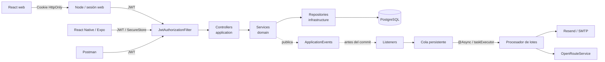
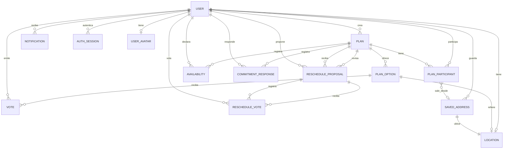

# QSale — Coordinación de planes grupales

**Curso:** CS 2031 Desarrollo Basado en Plataforma, 2026-2.

| Integrante | Aportes observables en Git | Cumplimiento declarado |
|---|---|---:|
| Gonzalo Gaviño | Integración web/móvil, despliegue, coordinación y reprogramación | 100 % |
| Mathias Pariona | Autenticación, usuarios, API de planes, eventos, correo y geografía | 100 % |
| Adriano Raffo | Modelo inicial, Docker, excepciones y documentación inicial | 100 % |

El resumen se apoya en los commits `063d5f2`, `a5641df`, `0cd19f7`, `1e6a305` y `5b16416`. Los porcentajes fueron declarados por el equipo; no se calculan por cantidad de commits ni sustituyen la confirmación de trabajo compartido.

## Índice

1. [Introducción](#1-introducción)
2. [Identificación del problema](#2-identificación-del-problema)
3. [Descripción de la solución](#3-descripción-de-la-solución)
4. [Modelo de entidades](#4-modelo-de-entidades)
5. [Manejo de errores](#5-manejo-de-errores)
6. [Medidas de seguridad](#6-medidas-de-seguridad)
7. [Eventos y asincronía](#7-eventos-y-asincronía)
8. [GitHub & Management](#8-github--management)
9. [Ejecución local y despliegue](#9-ejecución-local-y-despliegue)
10. [Conclusión](#10-conclusión)
11. [Apéndices](#11-apéndices)

---

## 1. Introducción

**Contexto.** Organizar una salida en grupo (una cena, un viaje, un cumpleaños) casi siempre ocurre en chats de WhatsApp mezclados con enlaces de mapas. Quién va, qué día le sirve a cada uno, dónde reunirse y cuánto gastar quedan dispersos entre mensajes y respuestas ambiguas como "creo que sí".

**Objetivos.**
- Centralizar en una API REST la creación de planes, las invitaciones y las respuestas de los participantes.
- Registrar disponibilidad, proponer y votar fechas y lugares.
- Comparar lugares según la distancia real del grupo usando un servicio de mapas.
- Medir la viabilidad del plan con un semáforo y avisar automáticamente cuando puede cerrarse.

## 2. Identificación del problema

**Descripción.** El organizador de un plan grupal no tiene una fuente única de verdad: insiste para obtener respuestas y decide sin saber qué opción le conviene a la mayoría ni quién está realmente comprometido.

**Justificación.** Es un problema cotidiano de cualquier grupo. Reducir la fricción de coordinar evita planes que nunca se concretan, y hacer explícitos el compromiso y la cercanía permite decisiones más justas.

## 3. Descripción de la solución

### Funcionalidades implementadas

| Funcionalidad | Cómo resuelve el problema |
|---|---|
| Registro y login con JWT | Cada participante tiene identidad propia |
| Planes con código de invitación | Tipo, presupuesto, mínimo de participantes y fechas tentativas, compartidos con un código |
| Invitaciones por email | El invitado recibe notificación y correo |
| Alternativas y votos | Fechas o lugares propuestos por el grupo, ordenados por puntaje |
| Disponibilidad | Días y horarios en que cada uno puede asistir |
| Nivel de compromiso | Confirmado, Me interesa o No puedo, en vez de respuestas ambiguas |
| Comparación geográfica | Distancia y tiempo promedio del grupo a cada lugar |
| Semáforo de viabilidad | Índice 0–100: `NOT_VIABLE`, `TO_BE_DEFINED` o `READY_TO_CLOSE` |
| Cierre del plan | Exige mínimo de asistentes y viabilidad suficiente, con día vigente y lugar votados; la hora es opcional |
| Asistencia después del cierre | Actualiza el conteo y avisa si se pierde el mínimo; conserva el acuerdo del grupo |
| Reprogramación | Propuestas con sí/no, mayoría y mínimo de asistentes; solo quien organiza aplica el cambio |
| Fechas recomendadas | Cruce de disponibilidad opcional, con coincidencia horaria y datos faltantes explícitos |
| Notificaciones y correos | Invitación, cambios, mínimo alcanzado, cierre o cancelación |
| Perfil | Apodo visible en los planes, apellido, teléfono, fecha de nacimiento, género y foto; el correo no se puede cambiar |
| Direcciones guardadas | Casa, oficina u otros lugares; la principal es el punto de partida y en cada plan se puede elegir otra |
| Días sueltos | Un plan puede proponer un rango de fechas o días específicos (hasta 31) |
| Calendario | Vista mensual de planes confirmados y tentativos; un plan confirmado se agrega al calendario del teléfono o a Google Calendar |

### Tecnologías utilizadas

- **Lenguaje y framework:** Java 21, Spring Boot 4.1 (Web MVC, Data JPA / Hibernate 7, Security, Validation, Mail, Thymeleaf, Actuator).
- **Base de datos:** PostgreSQL 16 (Docker en local).
- **Seguridad:** JWT con jjwt 0.12, BCrypt.
- **Mapeo:** ModelMapper.
- **API externa:** [OpenRouteService Matrix API](https://openrouteservice.org/) para distancias y tiempos de traslado, con respaldo por fórmula de Haversine.
- **Correo:** JavaMailSender + plantillas Thymeleaf; Mailpit como servidor SMTP de desarrollo.
- **Documentación:** Springdoc OpenAPI (Swagger UI) y colección de Postman.
- **Testing y CI:** JUnit 5, Mockito, Testcontainers, GitHub Actions.
- **Otros:** Lombok, Docker.
- **Web:** React, TypeScript, React Router, Axios, TanStack Query, React Hook Form y Zod; servidor Node para la sesión mediante cookie HttpOnly.
- **Móvil:** React Native y Expo Router, SecureStore para los tokens, cámara para invitaciones QR y ubicación GPS bajo solicitud.
- **Mapa en los clientes:** Leaflet y OpenStreetMap, con atribución y alternativa manual por coordenadas.

### Arquitectura



Los controladores reciben y validan solicitudes HTTP; los servicios concentran reglas y permisos; los repositorios encapsulan persistencia. Se usan DTO separados para entrada y salida, de modo que contraseñas y relaciones JPA internas no se publican. Flyway aplica las migraciones versionadas y Hibernate valida la correspondencia con las entidades. `@Version` en planes y opciones permite detectar modificaciones concurrentes.

## 4. Modelo de entidades



Las sesiones revocables, reprogramaciones y trabajos persistentes amplían el modelo inicial.

`User` guarda identidad, rol y ubicación opcional. `Plan` mantiene el presupuesto, mínimo de asistentes, fechas, código de invitación, estado y semáforo. `PlanParticipant` relaciona usuarios con planes y diferencia organizador, invitado y miembro unido. `PlanOption` contiene fechas o lugares propuestos; un lugar se asocia a `Location`, que guarda dirección y coordenadas. `Vote`, `Availability` y `CommitmentResponse` registran las decisiones individuales. `Notification` persiste avisos, fecha de lectura y estado de envío. `RescheduleProposal` guarda una alternativa de acuerdo con su versión, día, hora opcional, rango de fechas, lugar y vencimiento; `RescheduleVote` conserva la respuesta sí/no única de cada integrante. `SavedAddress` guarda los lugares desde donde sale cada usuario; la principal se copia a la ubicación del perfil y `PlanParticipant.originAddress` permite usar otra en un plan concreto. `UserAvatar` guarda la foto en su propia tabla para no cargar la imagen con cada usuario, y `Plan.tentativeDates` guarda los días sueltos. La base incluye unicidad de email, código de invitación, voto por usuario/opción y compromiso por usuario/plan; las claves foráneas e índices sostienen integridad y consultas frecuentes. Los DTO y Bean Validation restringen rangos, longitud y formato antes de guardar.

## 5. Manejo de errores

`GlobalExceptionHandler` transforma las excepciones del dominio en respuestas HTTP consistentes con marca temporal, estado, tipo, mensaje y ruta. Se distinguen entradas inválidas (`400`), autenticación ausente (`401`), acceso denegado (`403`), recurso inexistente (`404`) y conflictos (`409`). También se manejan validaciones de `@Valid`, JSON mal formado y errores inesperados (`500`). El filtro de seguridad usa su propio manejador para responder antes de entrar al controlador. Por ejemplo, un participante ajeno al plan recibe `403` incluso si conoce su identificador, y un voto repetido no se guarda dos veces. Un fallo de OpenRouteService no elimina el plan: activa el cálculo aproximado.

## 6. Medidas de seguridad

Spring Security protege la API con Bearer JWT y aplica permisos en los servicios mediante `@PreAuthorize`. USER y ADMIN se guardan en PostgreSQL; organizar un plan requiere autorización específica. El registro valida unicidad de correo y fortaleza de contraseña; BCrypt exige hasta 72 bytes UTF-8. No se puede retirar el acceso al último administrador.

Cada inicio de sesión tiene un registro revocable y guarda únicamente el hash del refresh. Renovarlo lo sustituye; reutilizar uno anterior revoca esa sesión. Logout invalida acceso y renovación sin afectar otros dispositivos. La web conserva acceso en memoria y refresh en cookie HttpOnly, Secure en producción y SameSite=Lax; el móvil usa SecureStore. Actualizar esta política exige reautenticar las sesiones anteriores.

CORS limita los orígenes y Express comprueba Origin al escribir. Los DTO no exponen contraseñas; las consultas parametrizadas evitan concatenar SQL. Las claves deben permanecer en el entorno. La edición incluye una versión y devuelve 409 si el formulario quedó desactualizado, conservando el borrador.

## 7. Eventos y asincronía

Registro, invitación, votos, estado y ubicación publican eventos. Las notificaciones y trabajos se persisten dentro de la transacción original: un rollback también elimina sus trabajos. Los workers asíncronos procesan correos y rutas, recuperan leases abandonados y reintentan con espera creciente hasta ocho intentos. Los completados se conservan siete días.

Una falla de correo conserva el aviso dentro de QSale. Un administrador consulta `GET /api/v1/admin/jobs` y reintenta con `POST /api/v1/admin/jobs/{id}/retry`. La entrega de correo es al menos una vez: una caída entre aceptación SMTP y commit podría duplicarla. Se usan plantillas Thymeleaf, Mailpit local y SMTP/Resend en producción. Haversine respalda rutas fallidas y se identifica como aproximación.

## 8. GitHub & Management

Las tareas se trabajan en ramas y PR por corrección, con commits descriptivos en inglés y validación previa. Los workflows comprueban Maven, TypeScript, unitarias, build, paquetes nativos y recorridos aislados. El fork `Adrian0raffo/QSale` permite validar con esa cuenta; la entrega continúa en `Gongl05/QSale`. Las ejecuciones no se trasladan entre repositorios: se enlaza su evidencia en el PR. El bloqueo de facturación del propietario original requiere soporte. No se acredita uso de Projects/milestones sin evidencia de su utilización.

## 9. Ejecución local y despliegue

Requisitos: Java 21, Node 24 y Docker. Ejecuta `docker compose up -d`, configura `JWT_SECRET` aleatorio de al menos 32 caracteres y lanza `./mvnw spring-boot:run` o `.\mvnw.cmd spring-boot:run`. API: 8080; PostgreSQL: 5433; SMTP: 1025; bandeja Mailpit: 8025. Swagger: `/swagger-ui.html`.

```sh
npm ci
npm run dev:web
npm run dev:mobile
```

La web abre en `http://127.0.0.1:5173`. Configura `API_URL=http://127.0.0.1:8080/api/v1` y `APP_ORIGIN` con el origen exacto. El puerto predeterminado 19080 corresponde a las pruebas aisladas. En el teléfono, `EXPO_PUBLIC_API_URL` debe ser accesible desde su red; `EXPO_PUBLIC_WEB_URL` define las invitaciones admitidas. Cámara y GPS se solicitan al usarlos; hay entrada manual.

Variables: `DB_HOST`, `DB_PORT`, `DB_NAME`, `DB_USER`, `DB_PASSWORD`, `CORS_ALLOWED_ORIGINS`, `MAPS_API_KEY`, `RESEND_API_KEY`, `MAIL_FROM` y `PLANS_TIME_ZONE`. Para los correos: `PUBLIC_URL` (URL pública de la API, de donde se carga el logo; en Render se usa `RENDER_EXTERNAL_URL`), `APP_WEB_URL` (botón «Crear mi primer plan») y `MAIL_SUPPORT` (correo de ayuda que aparece si alguien no reconoce su registro); las dos últimas son opcionales. AWS usa `SPRING_DATASOURCE_URL` hacia RDS con TLS y `SHOW_SQL=false`. El backend emplea el Dockerfile raíz; la web, `apps/web/Dockerfile`, puerto 3001 y HTTPS.

Validación: `./mvnw verify`, `npm run check`, `npm test`, `npm run build:web`, `npm run test:web` y `npm run test:mobile-form`. Los recorridos necesitan API temporal en 19080, PostgreSQL y correo local; nunca producción. Desde móvil, `npx expo-doctor` y `npx expo export --platform android --platform ios --output-dir dist` validan configuración y paquetes, sin certificar sensores, permisos o SecureStore físicos.

[Web documentada](https://web.98.94.89.19.sslip.io), [API](https://api.98.94.89.19.sslip.io/actuator/health) y [Expo anterior](https://expo.dev/accounts/gonzagl05/projects/qsale/updates/dc186f21-174e-4b8a-95c4-02d23966730a) dependen de la disponibilidad de AWS y la IP vigente. Expo corresponde a `f40ce94`; las correcciones requieren nuevo despliegue y publicación. Antes de evaluar, comprobar migraciones, JWT, CORS y un flujo con dos cuentas desde otra red. Las pruebas locales no certifican latencia pública ni disponibilidad continua.

## 10. Conclusión

**Logros.** QSale centraliza decisiones, compromiso y viabilidad. La solución combina reglas de negocio, transacciones, permisos por plan, eventos y servicios externos sin convertir cada fallo de correo o mapas en una caída del flujo principal.

**Aprendizajes clave.** Separar responsabilidades, proteger recursos por membresía y coordinar eventos requiere validar también las integraciones externas.

**Cierre pendiente.** Completar la revisión visual de todas las pantallas nativas y los permisos denegados, la disponibilidad durante la evaluación, la publicación de la versión corregida y su validación pública. El equipo debe contrastar los aportes resumidos en Git con su trabajo compartido.

## 11. Apéndices

- [Colección Postman](postman_collection.json): solicitudes, ejemplos y variables de prueba.
- [Migraciones](src/main/resources/db/migration): esquema inicial y metadatos de estimación.
- [CI](.github/workflows/ci.yml): validación automática con Maven y Testcontainers.
- [Dockerfile](Dockerfile): imagen del backend desplegada con Dokploy en EC2.
- **Licencia:** MIT, especificada en [LICENSE](LICENSE).
- **Referencias:** [Spring Boot](https://spring.io/projects/spring-boot), [OpenRouteService](https://openrouteservice.org/), [Resend API](https://resend.com/docs/api-reference/emails/send-email) y [Dokploy](https://docs.dokploy.com/docs/core/domains).
